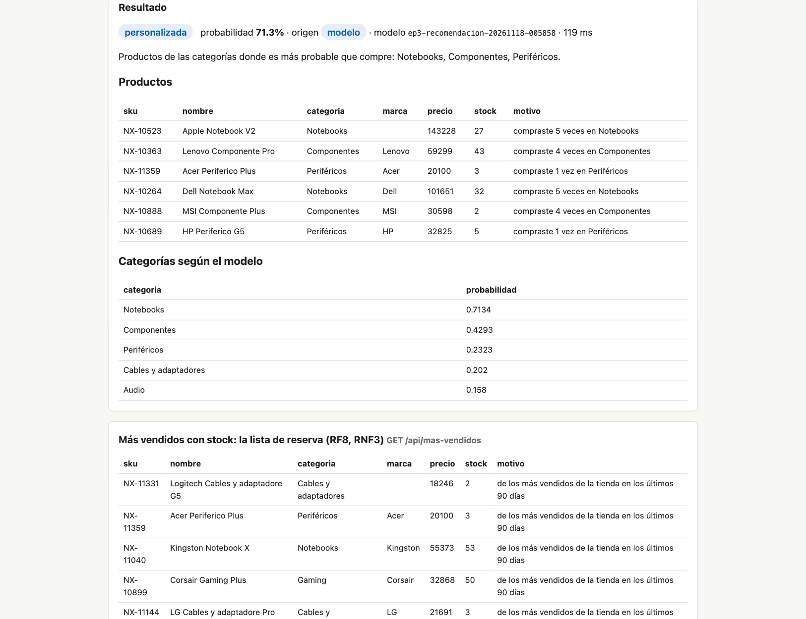
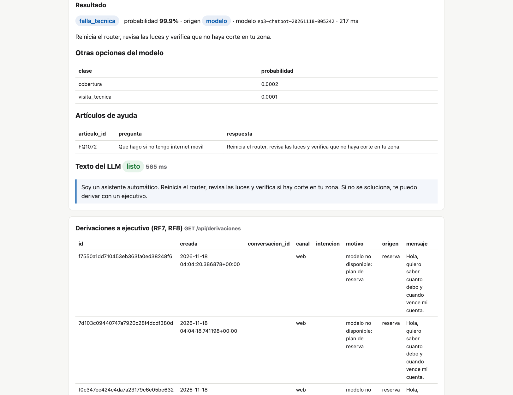
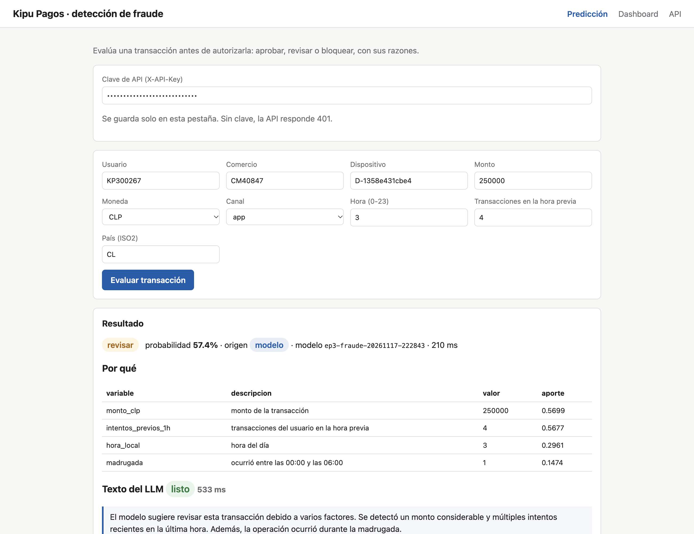

# 18 · Para un 7: qué exige el 100% y cómo se ve

**Para qué:** cada indicador de la presentación de EP3, con lo que la pauta pide para el 100%, la
secuencia de teclado, una respuesta modelo con números reales, las repreguntas probables y lo que te baja
la nota. Al final, un simulacro cronometrado para ensayarlo.

[← 17 · Problemas frecuentes](17-problemas-frecuentes.md) · [Índice](../README.md) · [19 · Conceptos →](19-conceptos.md)

---

## 18.1 La aritmética, sin ilusiones

| Logro en un IE | 100% | 80% | 60% | 30% |
|---|---|---|---|---|
| Nivel | Muy buen desempeño | Buen desempeño: «pequeñas omisiones» | Aceptable | Incipiente |
| Si **todos** los IE quedan ahí, la nota es | **7,0** | 5,5 | 4,0 | 2,5 |

Un 7 es **100% en todos los indicadores**, en el encargo y en la presentación. Basta con que el IE6 (18%)
quede en 80% para que la presentación baje a 96,4% y la nota a ~6,8. Por eso esta guía no puede
garantizarlo: el 80% de EP3 se juega en 15 minutos, en vivo, respondiendo con el teclado **ustedes**.

Tres reglas de EP3 §5.5 que deciden más que cualquier contenido:

1. **Una respuesta memorizada que no se sostiene al repreguntar = 30%.** Esta guía te da la estructura y
   los números de referencia; las respuestas tienen que salir de **tu** sistema y **tus** mediciones.
2. **Si algo falla y explicas con precisión qué, por qué y cómo se corrige, el indicador se sostiene.**
   El capítulo 17 y `/api/health` son tus herramientas para eso.
3. **La pregunta va primero al autor del pull request de esa pieza.** Si un integrante hizo todo, los
   demás no pueden responder: reparte las piezas **y los PR** (18.10).

---

## 18.2 IE3 · 18% · La decisión del negocio

**Pregunta:** «¿Qué decisión de la empresa del caso cambia porque existe este modelo? Muéstrame una
predicción en pantalla y dime qué haría con ella la persona que la recibe».

**El 100% (pauta 7.3):** conecta la salida del modelo con una **decisión concreta** de un **interesado**
y con **sus requerimientos**, y explica **el costo de un error** del modelo.

**Teclado:** el front, una predicción de tu ejemplo, y señalar en pantalla cada campo mientras hablas.

La respuesta tiene cinco piezas, en este orden: **quién · qué decide · qué ve · qué requerimiento ·
cuánto cuesta equivocarse**.

**Abre tu caso** (los tres bloques tienen la misma estructura; los números son los medidos con esta
plantilla en el Learner Lab, **di los tuyos**):

<details>
<summary><b>Caso 1 · Recomendación (Nexus Retail)</b></summary>

> «La decisión es **qué 4 a 8 productos mostrarle a cada cliente** en la ficha y en la home, y **qué
> campaña mandarle** por Mailchimp. La toma marketing, con la gerenta de e-commerce mirando el
> dashboard. Este cliente [señala] recibe primero productos de las categorías donde es más probable que
> compre —Notebooks, Componentes, Periféricos—, cada uno con su motivo: "compraste 5 veces en
> Notebooks" (RN3), y nada sin stock (RF5). Solo se personaliza a quien dio consentimiento (RN2).
> El costo de equivocarse es asimétrico: mostrar algo irrelevante ocupa un espacio que podría haber
> vendido; no mostrar lo que el cliente iba a comprar es una venta perdida. Medido: en 3 categorías el
> modelo acierta donde compró el cliente el 80,6% de las veces, contra 47,9% de los más vendidos».



</details>

<details>
<summary><b>Caso 2 · Chatbot (Andesnet)</b></summary>

> «La decisión es **responder solo con un artículo de ayuda o derivar a un ejecutivo**. El modelo
> reconoce la intención [señala: `falla_tecnica`, 99,9%, y las dos alternativas]; la derivación la deciden
> reglas, no el modelo ni el LLM: anular, molestia, tres intentos fallidos o pedir una persona (RF8,
> RNF11). Experiencia de clientes mira la tasa de derivación en el dashboard (RNF9). Equivocarse en la
> intención significa responder con el artículo equivocado: el cliente insiste y, al tercer intento, se
> deriva; el costo es tiempo del cliente y un ejecutivo ocupado. Lo medimos con 20 mensajes escritos por
> nosotros, distintos de los de entrenamiento: 11 con la intención correcta, 3 pidiendo aclarar y 6
> equivocados (un cobro no reconocido salió `falla_tecnica`). Por eso el F1 de 1,0 del conjunto de prueba
> no es creíble, por eso hay umbral de confianza, y por eso derivar no depende del modelo. Hasta el LLM
> lo notó: ante un artículo que no correspondía, ofreció derivar».



</details>

<details>
<summary><b>Caso 3 · Fraude (Kipu Pagos)</b></summary>

> «La decisión es **si una transacción se aprueba, se manda a revisión o se bloquea**, y la toman dos
> interesados: el core de pagos, en línea, y los seis analistas de fraude, en la cola de revisión. Esta
> transacción salió **revisar** con 57% de probabilidad [señala]. El analista ve **por qué**: monto de
> 250.000, cuatro intentos en la hora previa, de madrugada [señala las razones, RF2]. Con eso decide en
> segundos en vez de investigar desde cero. Los umbrales se cambian en configuración sin desplegar (RF3).
> Equivocarse cuesta distinto en cada lado: un falso positivo bloquea a un cliente bueno, y eso le cuesta
> a Kipu USD 1,16 millones al año, más del doble que el fraude, USD 0,5 millones. Por eso no
> optimizamos accuracy: en prueba, el modelo de SageMaker tuvo 5 falsos positivos y 4 falsos negativos
> sobre 308 transacciones, con PR-AUC 0,95 contra 0,11 del azar».



</details>

**Repreguntas probables:**

| Repregunta | Lo que tiene que estar en la respuesta |
|---|---|
| «¿Y si el modelo se cae?» | La política de reserva de tu caso (RNF3) y **mostrarla**: `docker compose stop ia` en la EC2 → `origen: reserva` |
| «¿Quién define el umbral y con qué criterio?» | El costo de FP vs FN de tu caso; dónde está (`modelo/config.json`, `.env`, `UMBRAL_*`); el desafío D1 de tu ficha |
| «¿Cómo sabes que la decisión es mejor que sin modelo?» | La línea base de `METRICAS.md` y el número de tu caso |
| «¿El LLM decide algo?» | No: redacta a partir de lo que el modelo y las reglas ya decidieron (EP3 §9) |

**Te baja a 80%:** no nombrar al interesado o no dar el costo del error con número. **A 30%:** describir
el modelo («predice fraude») sin la decisión que cambia.

---

## 18.3 IE6 · 18% · La configuración del endpoint

**Pregunta:** «Tu endpoint no se ha usado en 10 minutos. Invócalo y mide el tiempo. Ahora otra vez.
¿Por qué cambia? ¿Por qué serverless con esa memoria, y cuánto cuesta al volumen de tu caso comparado
con Bedrock o con el modelo dentro del contenedor?».

**El 100%:** **mide el cold start en vivo**, lo explica y **defiende la configuración con números de
rendimiento y costo frente a una alternativa concreta**.

**Teclado** (desde CloudShell o tu computador con credenciales del laboratorio, en la carpeta del repo):

```bash
python3 sagemaker/4_probar.py          # 1.ª y 2.ª invocación, p50/p95 de 20 en caliente
```

o, sin credenciales, desde el front: una predicción y mira `latencia_ms` y `origen`; luego otra.
Después, CloudWatch → dashboard `proyecto-ep3` → `ModelSetupTime`.

**Lo que vas a ver, en los tres casos** (medido en el Learner Lab): después de 10 minutos sin uso, el
primer contenedor serverless tarda **5,8 a 6,8 s** en arrancar (`ModelSetupTime`), y tu dominio no lo
espera: aplica la reserva. **Ojo con las ráfagas en frío:** cada predicción que llega mientras los
contenedores arrancan enciende **otro** contenedor frío, hasta el límite de concurrencia. Por eso, antes
de una demo, **haz una sola predicción, espera unos 10 segundos** y recién ahí sigue; diez predicciones
seguidas en frío dan diez reservas.

**Respuesta modelo, abre tu caso** (números medidos con esta plantilla; **di los tuyos**):

<details>
<summary><b>Caso 1 · Recomendación</b> · TIMEOUT 200 ms · 1.000.000 invocaciones/mes</summary>

> «Después de un rato sin uso hice 20 predicciones seguidas y **todas salieron por reserva**, los más
> vendidos en ~206 ms: el dominio espera 200 ms (`TIMEOUT_MODELO_MS`, RNF3) y SageMaker estaba
> arrancando contenedores. En el log de la IA hay **10 invocaciones de 5,8 a 6,8 s**, una por contenedor:
> con concurrencia 10, una ráfaga en frío enciende hasta 10. CloudWatch lo confirma: `ModelSetupTime`
> **6,25 s** [señala]. Esperé 10 segundos y 19 de 20 salieron por el modelo: p50 69 ms y p95 186 ms en el
> dominio; el modelo mismo responde en 3,7 ms promedio (`ModelLatency`). Esa es la diferencia: arrancar
> un contenedor contra usarlo caliente.
>
> **Memoria 2048 MB** y **concurrencia 10**: el modelo es pequeño; con 10 la prueba de carga tuvo solo 3
> reservas en 492 predicciones [si mediste 1024 MB o concurrencia 2, dilo: DESAFÍO S3].
>
> **Costo**, 1.000.000 de recomendaciones al mes con 60 ms y 2 GB: **USD 2,40/mes**. Un endpoint de tiempo
> real `ml.t2.medium` cuesta **USD 40,88/mes**, 17 veces más, a cambio de no tener cold start. A este
> volumen gana el serverless, y el cold start lo absorbe la reserva: el cliente ve los más vendidos en vez
> de su recomendación, nunca un error. El modelo dentro del contenedor no cuesta extra; Bedrock no aplica
> porque sirve LLM, no nuestro XGBoost».

</details>

<details>
<summary><b>Caso 2 · Chatbot</b> · TIMEOUT 1500 ms · 1.360.000 invocaciones/mes</summary>

> «Tras un rato sin uso, los **4 primeros mensajes salieron por reserva**: el asistente derivó a un
> ejecutivo con aviso honesto, en 1.503 ms, porque el dominio espera 1,5 s. En el log de la IA hay **4
> invocaciones de 6,0 a 6,3 s**: cada mensaje que llegó mientras los contenedores arrancaban encendió otro.
> `ModelSetupTime` en CloudWatch: **5,8 s** [señala]. En caliente, la IA responde en 36 a 60 ms y el modelo
> en 13 ms promedio (`ModelLatency`). Esas 4 derivaciones por reserva son el costo real del cold start
> en nuestro caso: un ejecutivo ocupado sin necesidad.
>
> **Memoria 2048 MB** y **concurrencia 10**: en la prueba de carga, 0 reservas en 482 mensajes [si
> mediste otra configuración, dilo: DESAFÍO S3].
>
> **Costo**, 340.000 contactos × ~4 mensajes = 1.360.000 invocaciones al mes: **USD 3,26/mes** serverless
> contra **USD 40,88/mes** de un `ml.t2.medium` de tiempo real. Pero en nuestro sistema el costo lo manda el
> LLM: **USD 153** de un total de **USD 193** al mes. Optimizar el endpoint ahorra centavos; guardar y
> reutilizar el texto del LLM cuando se repiten la intención y el artículo (sin datos del cliente) ahorra
> dólares. Bedrock no reemplaza a nuestro clasificador, pero sí sería una alternativa para el LLM».

</details>

<details>
<summary><b>Caso 3 · Fraude</b> · TIMEOUT 300 ms · 6.000.000 invocaciones/mes</summary>

> «Después de horas sin uso, la primera predicción tardó **6,2 s** en el servicio de IA y las siguientes,
> 45 a 130 ms. La diferencia es el **cold start**: el endpoint es serverless, SageMaker apaga el contenedor
> tras unos minutos sin uso y la primera invocación tiene que arrancarlo y cargar el modelo. AWS lo mide
> en `ModelSetupTime`: **6,2 s** [señala el gráfico]. Como el dominio espera 300 ms
> (`TIMEOUT_MODELO_MS`), la predicción fría salió por **reserva**: es nuestra política de RNF3.
>
> **Memoria 2048 MB**: el modelo XGBoost es pequeño y en caliente responde en 3 a 22 ms (`ModelLatency`).
> El costo serverless es proporcional a la memoria, así que la pregunta es si con 1024 MB sigue igual de
> rápido y cuesta la mitad [si lo mediste, dilo con tu número: DESAFÍO S3]. **Concurrencia 10**, no 2:
> con 2 medimos `ThrottlingException` y 23% de decisiones por reserva en la prueba de carga; con 10, 1%.
>
> **Costo** al volumen del caso, 200.000 transacciones diarias = 6 millones de invocaciones al mes, con
> 60 ms y 2 GB: **USD 14,40/mes**. La alternativa concreta es un endpoint de tiempo real `ml.t2.medium`:
> **USD 40,88/mes** por instancia, sin cold start, el doble para alta disponibilidad. El serverless es más
> barato hasta ~17 millones de invocaciones al mes. El modelo dentro del contenedor no cuesta extra y es
> el más rápido, pero acopla escalar y cambiar el modelo al servicio. Bedrock no aplica: sirve modelos
> fundacionales, no nuestro XGBoost. **Para el p99 < 100 ms del caso** el serverless no alcanza (p95 de
> 102 ms en el dominio), así que en producción propondríamos tiempo real o el modelo en el contenedor».

</details>

Los costos los da `python3 herramientas/costos.py --latencia-ms <tu ModelLatency promedio>` (capítulo
11.8). Referencia de los tres casos con 60 ms y 2 GB:

| Caso | Invocaciones/mes | Serverless | Tiempo real 1× `ml.t2.medium` | Total del sistema/mes |
|---|---|---|---|---|
| Fraude | 6.000.000 | USD 14,40 | USD 40,88 | USD 76,77 |
| Recomendación | 1.000.000 | USD 2,40 | USD 40,88 | USD 42,38 |
| Chatbot | 1.360.000 | USD 3,26 | USD 40,88 | USD 193,10 (el LLM: 153) |

> **Para que el cold start aparezca en vivo**, el endpoint tiene que estar 10 minutos sin uso **antes**
> de la pregunta. Si la hacen justo después de la demo, no habrá cold start: dilo y muestra el
> `ModelSetupTime` de CloudWatch y tu medición del informe. Eso también es medir.

**Repreguntas probables:**

| Repregunta | Respuesta |
|---|---|
| «¿Cómo eliminarías el cold start y cuánto cuesta?» | Concurrencia provisionada (cobra por hora aunque no haya tráfico), un *ping* de calentamiento cada pocos minutos (casi gratis, es un parche), tiempo real (USD 40,88/mes). Con el volumen de producción del caso el contenedor casi no se enfría |
| «¿Qué pasa si llegan 50 solicitudes a la vez?» | Las que pasan la concurrencia reciben `ThrottlingException` → la IA responde 503 → el dominio aplica la reserva. Nadie ve un error; la decisión es peor. Lo medimos |
| «¿Por qué la latencia del front es mayor que `ModelLatency`?» | Suma red Chile–Virginia, Caddy, gateway, dominio, base y la sobrecarga de SageMaker (`OverheadLatency`) |
| «¿Dónde configuraste eso?» | `sagemaker/3_endpoint.py` (`--memoria`, `--concurrencia`) y *SageMaker → Endpoint configurations* |

**Te baja a 80%:** no medir en vivo (solo recitar), o costo sin alternativa. **A 30%:** no saber la
memoria ni la concurrencia de tu propio endpoint.

---

## 18.4 IE8 · 9% · El LLM falla y el sistema sigue

**Pregunta:** «Te cambio la `NVIDIA_API_KEY` del servidor por una inválida y reinicio el worker. Haz una
predicción. ¿Qué ve el usuario, qué queda en la cola y qué se registra?».

**El 100%:** provoca la falla, **muestra el modo degradado**, explica **el flujo por la cola** y **ubica
en el código el reintento y el tiempo de espera**.

**Teclado, en la EC2** (`cd ~/<repo>`):

```bash
cp .env .env.respaldo
sed -i 's/^NVIDIA_API_KEY=.*/NVIDIA_API_KEY=invalida/' .env
docker compose up -d worker             # «restart» NO relee el .env: hay que recrearlo con up -d
# → una predicción que encola (tabla de abajo), desde el front
docker compose logs worker --tail 5
docker compose exec -T rabbitmq rabbitmqctl list_queues name messages
curl -s localhost:8080/api/health        # o /api/health por HTTPS
cp .env.respaldo .env && docker compose up -d worker   # volver
```

> **La trampa:** `docker compose restart worker` reinicia el contenedor **con las variables viejas**. La
> clave inválida no se aplica y el texto llega igual. Si el docente lo hace así y el LLM sigue
> funcionando, explícalo: eso también es dominar el sistema.

**Qué pedido encola texto en tu caso** (si haces uno que no encola, no hay nada que degradar):

| Caso | Pedido que pasa por el LLM | Uno que **no** pasa (útil para contrastar) |
|---|---|---|
| 1 · Recomendación | `POST /api/campanas/{usuario}` de un cliente con consentimiento (lista *Campañas* del front) | `POST /api/predict`: la recomendación nunca usa el LLM |
| 2 · Chatbot | Cualquier mensaje que no se derive (el ejemplo del front) | «quiero hablar con una persona»: deriva por regla, sin LLM |
| 3 · Fraude | Una transacción que salga `revisar` o `bloquear` | Una que salga `aprobar` |

**Respuesta modelo:**

> «El usuario ve su predicción completa, con la decisión y las razones, y abajo **degradado: sin texto
> del LLM (HTTP 401)** [señala]. La predicción nunca esperó al LLM: el dominio guardó la decisión,
> respondió y publicó un mensaje en la cola `llm`. El worker lo tomó, llamó a NVIDIA, recibió 401 y, como
> una clave mala no se arregla esperando, **no reintentó**: marcó la predicción como degradada por
> `PUT /interno/predicciones/{id}/llm` y mandó el mensaje a `llm.fallidos` [señala `list_queues`:
> `llm 0`, `llm.fallidos 1`]. En `/api/health`, `llm: degradado: HTTP 401`.
>
> El reintento está en `servicios/worker/app/llm.py` [abre]: `INTENTOS = 4` en la línea 14,
> `TIMEOUT = 20` segundos por intento en la 13; ante 429 o 5xx espera `ESPERA_BASE * 2 ** (intento - 1)`
> más un azar (línea 53–54), y respeta `retry-after` si NVIDIA lo manda. Ante 401 o 404 sale al tiro
> (línea 45). El envío a la cola de fallidos es `basic_nack(requeue=False)` en `worker.py`».

Ensáyalo antes: en el ensayo local (`herramientas/ensayo-nube.sh`) y en la EC2 se comprobó exactamente
esto (capítulo 12.5).

**Repreguntas probables:** «¿Y si el que se cae es RabbitMQ?» (`degradado` con `cola: AMQPConnectionError`;
la predicción sale igual). «¿Y si NVIDIA responde 429?» (4 intentos con espera creciente; mostrar con
`DOBLE_LLM=429` en el ensayo). «¿Qué pasa con los mensajes de `llm.fallidos`?» (quedan para revisarlos o
reprocesarlos a mano; no se pierden).

**Te baja a 80%:** no encontrar el reintento en el código. **A 30%:** que el sistema deje de predecir.

---

## 18.5 IE9 · 12% · La demo, los cinco pasos

**El 100%:** los cinco pasos de EP3 §5.3 funcionan en AWS durante el turno. Guion completo en el
capítulo 16.3; lo que separa el 100% del 80%:

| Paso | Lo que tiene que verse | Cómo asegurarlo |
|---|---|---|
| 1 · Front → SageMaker → pantalla | `origen: modelo` y `modelo ep3-<caso>-…` | **Calienta** el endpoint antes del turno: **una** predicción y espera unos 10 s (varias seguidas en frío dan varias reservas, 18.3). Si igual sale `reserva`, explícalo |
| 2 · Texto del LLM por la cola | `estado_llm: listo` aparece solo | La cola vacía: si corriste Locust antes, `purge_queue llm` (capítulo 12.5) |
| 3 · `curl` con clave (200) y sin clave (401) | Los dos códigos | Los comandos en un archivo, con `B` y `K` ya definidos |
| 4 · Dashboard | `/dashboard.html` con números | Que haya predicciones del día |
| 5 · La invocación en CloudWatch | El punto nuevo en `Invocations` | Las métricas tardan **1–2 min**: la predicción del paso 1 es la que vas a mostrar en el 5 |

Si algo falla: **`/api/health`** dice qué pieza está mal. Nombrarla y decir la causa (capítulo 17)
sostiene el indicador.

---

## 18.6 IE11 · 7% · Locust en vivo

**Pregunta:** «Corre tu prueba de Locust durante un minuto contra el sistema desplegado. Léeme el p95.
¿Cumple el RNF de rendimiento de tu caso? Si no, ¿qué cambiarías primero y cuánto cuesta?».

**Teclado:**

```bash
# en la EC2, ANTES: si no, mides el 429 de tu propio rate limiting
sed -i 's/^LIMITE_POR_MINUTO=.*/LIMITE_POR_MINUTO=100000/' .env && docker compose up -d dominio
# en tu computador
API_KEY=<clave> locust -f pruebas/locustfile.py --host https://<tu-nombre>.sslip.io --headless -u 10 -r 5 -t 1m
# en la EC2, DESPUÉS
sed -i 's/^LIMITE_POR_MINUTO=.*/LIMITE_POR_MINUTO=60/' .env && docker compose up -d dominio
docker compose exec -T rabbitmq rabbitmqctl purge_queue llm     # si tu ejemplo encola texto
```

**Respuesta modelo, abre tu caso** (Locust desde un computador en Chile, 10 usuarios, 1 minuto, contra la
EC2 del Learner Lab con endpoint serverless de concurrencia 10):

<details>
<summary><b>Caso 1 · Recomendación</b> · RNF1: p95 &lt; 200 ms en el borde del servicio</summary>

> «485 solicitudes, 0 errores, 8,2 por segundo. Desde aquí: p50 200, **p95 270**, p99 430 ms. Pero el RNF
> se mide **en el borde del servicio**, sin la red de Chile a Virginia: en el dominio, las 489
> predicciones por el modelo tuvieron **p95 de 113 ms**, y solo 3 salieron por la reserva. **Cumple** dentro
> del sistema; un cliente en Chile suma ~150 ms de red. Lo primero que cambiaría es **precalcular las
> recomendaciones de los clientes con consentimiento cada noche** y guardarlas en la base: la respuesta
> deja de depender de SageMaker en línea; cuesta un proceso nocturno [estímenlo con la calculadora:
> SageMaker Batch Transform]. Lo segundo, servir desde una región más cerca de Chile y medir».

</details>

<details>
<summary><b>Caso 2 · Chatbot</b> · RNF1: p95 &lt; 3 s hasta la respuesta del LLM</summary>

> «474 solicitudes, 0 errores, 8 por segundo; la respuesta inmediata (la intención): p50 210, p95 320 ms
> desde aquí, 103 ms en el dominio, sin reservas. **Pero nuestro RNF incluye el LLM.** Sin carga, con 20
> mensajes (`herramientas/evaluar_llm.py`), el texto estuvo listo en **p50 1,16 s y p95 1,79 s: cumple.**
> Bajo esta carga **no**: al terminar el minuto quedaban **361 mensajes en la cola**, porque un worker
> despacha ~1,6 textos por segundo y llegaban 8. Lo primero que cambiaría: **más workers**. Con 4
> (`docker compose up -d --scale worker=4`, ~53 MB de RAM cada uno, sin costo extra en la misma EC2) la
> cola terminó en 39, pero aparecieron respuestas 429 de NVIDIA: el siguiente límite es el del
> proveedor, que se resuelve con un plan pagado (USD 153/mes a nuestro volumen)».

</details>

<details>
<summary><b>Caso 3 · Fraude</b> · RNF1: p99 &lt; 100 ms</summary>

> «475 solicitudes, 0 errores, 8 por segundo. p50 210, **p95 310**, p99 500 ms, medido desde aquí: incluye
> la red hasta Virginia, ~150 ms si lo comparo con lo que mide el dominio. **No cumple** el p99 < 100 ms.
> Pero el RNF se mide en el borde del servicio: en el dominio, la predicción por el modelo tuvo p95 de
> 102 ms, que tampoco cumple. Lo primero que cambiaría es **sacar el modelo del serverless**: un endpoint
> de tiempo real (USD 40,88/mes, sin cold start) o el modelo dentro del contenedor de IA (sin costo
> extra, sin el salto de red; es lo que teníamos en EP2). Lo segundo, la red del cliente: desplegar en
> una región más cercana a Chile, como São Paulo, y medir cuánto baja».

</details>

> **Después de Locust, vacía la cola** si tu ejemplo encola texto (chatbot siempre; fraude si sale
> `revisar`/`bloquear`): `docker compose exec -T rabbitmq rabbitmqctl purge_queue llm`.

**Te baja a 80%:** leer el número sin compararlo con el RNF o sin decir dónde se midió. **A 30%:** no
poder lanzar la prueba (el `LIMITE_POR_MINUTO` olvidado da cientos de 429: si pasa, **dilo**, es tu
rate limiting funcionando).

---

## 18.7 IE13 · 12% · Teclado sin ayuda

**Variante A:** «Agrega un caso de prueba que mande una entrada inválida y muéstrame el `422`».

```bash
# al final de servicios/dominio/tests/test_caso_<caso>.py
herramientas/probar.sh dominio -k entrada_invalida
```

**Abre tu caso.** Las tres pruebas se escribieron y corrieron así (`1 passed`), y las tres fallan con
`assert 200 == 422` si cambias el valor por uno válido:

<details>
<summary><b>Caso 1 · Recomendación</b> · <code>"cantidad": 9</code> (RF1: entre 4 y 8)</summary>

```python
# al final de servicios/dominio/tests/test_caso_recomendacion.py
def test_entrada_invalida_responde_422(sistema):
    malo = {**sistema["caso"].EJEMPLOS["valido"], "cantidad": 9}
    r = sistema["cliente"].post("/api/predict", json=malo, headers=CLAVE)
    assert r.status_code == 422
    assert r.json()["detail"][0]["loc"] == ["body", "cantidad"]
```

Para mostrar que detecta algo: `"cantidad": 6` → falla.

</details>

<details>
<summary><b>Caso 2 · Chatbot</b> · <code>"canal": "fax"</code> (solo web, whatsapp o app)</summary>

```python
# al final de servicios/dominio/tests/test_caso_chatbot.py
def test_entrada_invalida_responde_422(sistema):
    malo = {**sistema["caso"].EJEMPLOS["valido"], "canal": "fax"}
    r = sistema["cliente"].post("/api/predict", json=malo, headers=CLAVE)
    assert r.status_code == 422
    assert r.json()["detail"][0]["loc"] == ["body", "canal"]
```

Para mostrar que detecta algo: `"canal": "app"` → falla.

</details>

<details>
<summary><b>Caso 3 · Fraude</b> · <code>"monto": -5</code></summary>

```python
# al final de servicios/dominio/tests/test_caso_fraude.py
def test_entrada_invalida_responde_422(sistema):
    malo = {**sistema["caso"].EJEMPLOS["valido"], "monto": -5}
    r = sistema["cliente"].post("/api/predict", json=malo, headers=CLAVE)
    assert r.status_code == 422
    assert r.json()["detail"][0]["loc"] == ["body", "monto"]
```

Para mostrar que detecta algo: `"monto": 5000` → falla.

</details>

Explica cada línea mientras la escribes (capítulo 15.3): la *fixture* `sistema`, el ejemplo válido que
rompes, la clave (sin ella sería 401) y `loc`, que dice **qué** campo falló.

**Variante B:** «Muéstrame en CloudWatch los logs de la predicción que acabo de hacer».

1. Copia el `id` de la respuesta (en el front o en el `curl`).
2. CloudWatch → Log groups → `/ity1102/proyecto` → **Search all log streams** → pega el `id`.
3. Señala la línea del **gateway** (llegó), del **dominio** (decidió: `origen`, `version_modelo`,
   `latencia_ms`) y del **worker** (el LLM). Captura de referencia en el capítulo 14.2.

**El 100%:** sin ayuda externa, explicando cada paso, **y cada integrante responde sobre su parte**.
**Te baja:** pedir ayuda a un compañero que no es el autor; no saber qué es la *fixture* `sistema`.

---

## 18.8 IE12 · 4% · El lenguaje

Se evalúa toda la presentación. Los siete términos del IE (endpoint, cold start, concurrencia, latencia
de percentil, rate limiting, modo degradado, interpretabilidad) y los demás, con dónde mostrarlos en tu
sistema y el error típico: **[capítulo 19](19-conceptos.md)**. La estructura de una respuesta precisa:
**número · causa · métrica que lo prueba · consecuencia en el sistema · decisión**.

---

## 18.9 El encargo (20%): el 100% de cada IE

| IE | % | El 100% exige | Tu evidencia | Plantilla |
|---|---|---|---|---|
| IE1 | 6 | Modelo propio, datos tratados del caso, scripts versionados, `InService`, consumido con el rol. Modelo, datos, hiperparámetros y configuración documentados | `sagemaker/estado.json`, captura `InService`, `4_probar.py` | [`entrega/informe-ep3.md`](../entrega/informe-ep3.md) §1 |
| IE2 | 6 | El usuario entiende qué se decidió y **por qué**; el LLM cumple su rol; funciona sin él | Captura del front con razones; captura degradado | §2 |
| IE4 | 2 | Configuración justificada, cold start **medido dos veces**, costo **al volumen del caso** por servicio, CloudWatch | `costos.py`, `ModelSetupTime`, dashboard | §3 |
| IE5 | 2 | Servidor, modelo, **dataset en S3** y dashboard operativos; URLs del anexo C respondiendo | `1_subir.py` (bucket), URLs | §3 y anexo C |
| IE7 | 2 | Rutas en `/docs`; HTTPS, autenticación, validación, rate limiting, anonimización; **sin secretos ni access keys** | `/docs`, 401/422/429, `.env` fuera del repo | §4 |
| IE10 | 2 | ≥ 10 pruebas en el pipeline (incluidas las 6); Locust **3 minutos** con p50/p95/p99/req/s/errores; métricas vs línea base; **3 optimizaciones con costo**; caso 2: los 20 mensajes evaluados a mano | `probar.sh`, workflow verde, `carga_stats.csv`; caso 2: `evaluacion_llm.csv` (`herramientas/evaluar_llm.py`) | §5 |

`herramientas/evidencias.sh` junta en un solo archivo lo que el informe necesita (versiones, salud,
métricas, reporte de datos, resultados de carga, consumo de recursos): úsalo para no inventar ningún
número.

---

## 18.10 Repartir para que todos respondan

La pregunta va al autor del PR. Un reparto que cubre las preguntas, para 2 o 3 integrantes:

| Integrante | Piezas (sus PR) | Responde primero |
|---|---|---|
| A | `datos/`, `modelo/`, `sagemaker/` | IE3 (con todos), IE6 |
| B | `servicios/dominio`, `servicios/worker`, `comun/anonimizar.py`, pruebas | IE8, IE13 variante A |
| C (o A+B) | `compose*`, `Caddyfile`, `.github/workflows`, `herramientas/cloudwatch.py`, Locust | IE9, IE11, IE13 variante B |

**Todos** deben poder hacer el IE13 variante A y explicar el flujo de una predicción de punta a punta.

---

## 18.11 Simulacro: 15 minutos, como el día de la presentación

Háganlo **al menos dos veces** (la segunda, con la EC2 recién encendida y el endpoint frío). Uno de
ustedes, o alguien de otro equipo, hace de docente y elige a quién preguntar.

| Minuto | Qué | Cronómetro |
|---|---|---|
| 0–4 | Láminas (IE3) | Cortar en 4:00 |
| 4–9 | Demo: los 5 pasos (IE9) | Si en 9:00 no terminó el paso 5, anótalo |
| 9–15 | Tres preguntas al azar entre IE6, IE8, IE11, IE13 | 2 minutos cada una |

**Hoja de autoevaluación** (márquenla honestamente después de cada simulacro):

| IE | ¿Lo logramos sin mirar la guía? | Nivel honesto | Qué faltó |
|---|---|---|---|
| IE3 | Interesado · decisión · campo en pantalla · requerimiento · costo del error con número | | |
| IE6 | Medimos frío y caliente en vivo · memoria y concurrencia con razón · costo vs una alternativa | | |
| IE8 | Clave inválida con `up -d` · degradado en pantalla · `list_queues` · `llm.py` líneas 13–14 y 45–57 | | |
| IE9 | Los 5 pasos en < 5 min | | |
| IE11 | Rate limit subido y bajado · p95 leído · RNF comparado · optimización con costo | | |
| IE12 | Ningún término mal usado (19) | | |
| IE13 | Prueba escrita y corrida < 3 min por cada integrante · log por `id` en CloudWatch | | |

Si en el segundo simulacro algún IE no llega a «sin mirar la guía», ahí está el tiempo que queda.

[Siguiente: 19 · Conceptos →](19-conceptos.md)
